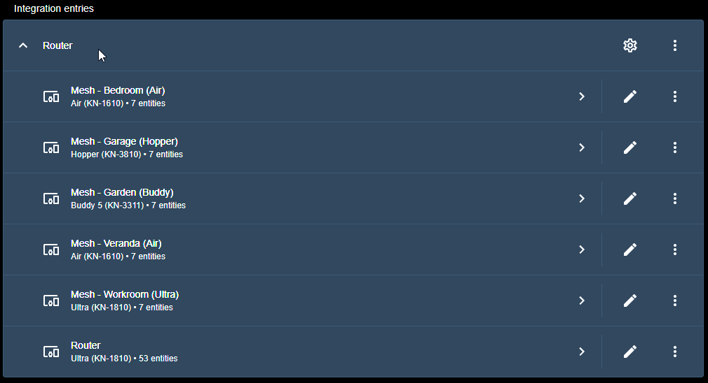
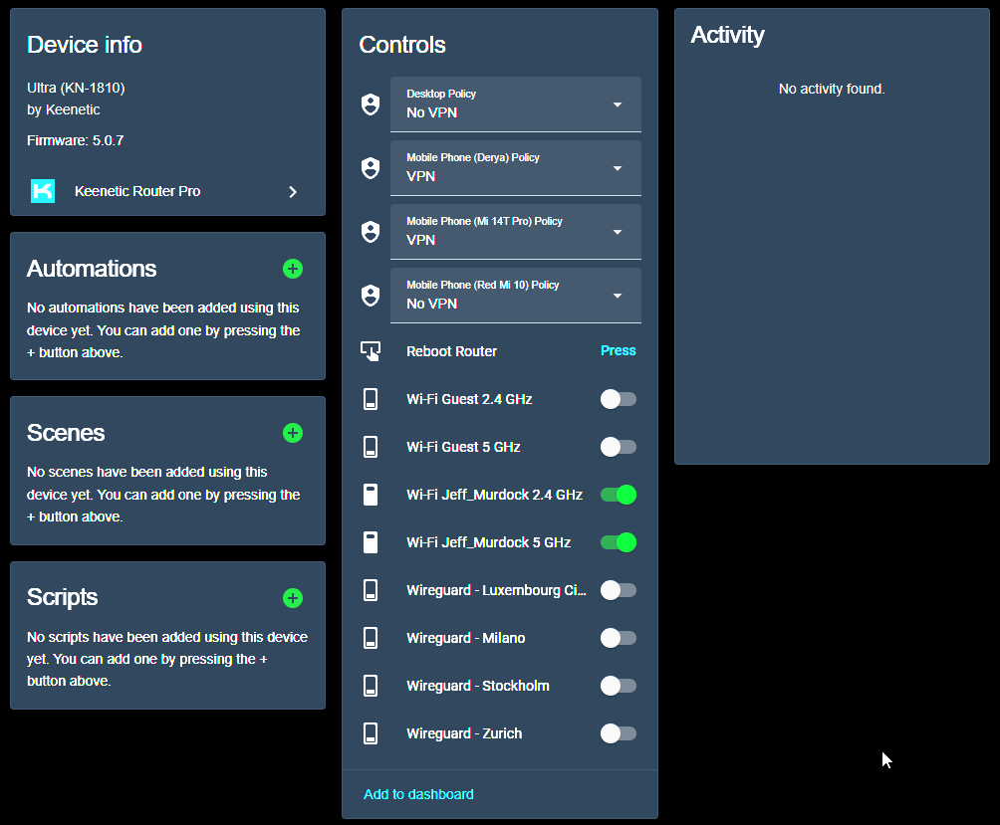
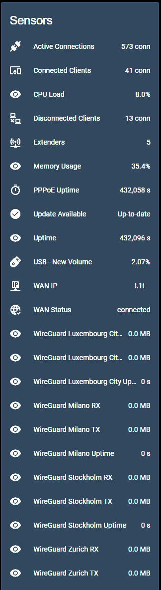
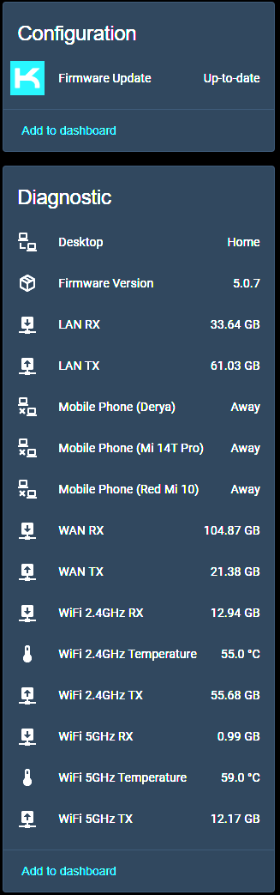
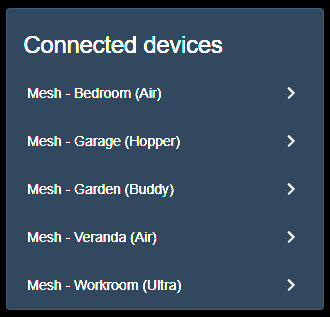
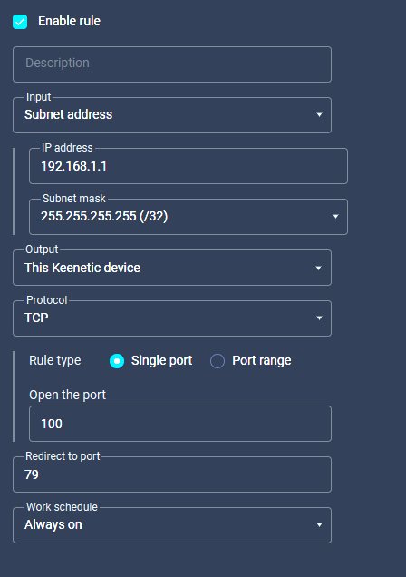
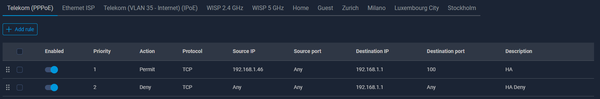

# Keenetic Router Pro - Home Assistant Integration

[](https://github.com/custom-components/hacs)
[](https://github.com/cataseven/Keenetic-Router-Pro/releases)

<a href="https://www.buymeacoffee.com/cataseven" target="_blank">
  
</a> 

An advanced Home Assistant integration for Keenetic routers. Provides mesh network management, VPN control, device tracking, traffic monitoring, firmware updates, per-device bandwidth limiting, port forwarding control, 4G/LTE data-usage tracking, and more.

## 🌟 Features

### 📡 Real Time Device Tracking

* Real-time device status via **ICMP Ping**. You don't need to wait Keenetic's update time for device tracking. This integration pings the devices you selected every 5 seconds by default (adjustable in the options).
* Selectable client list — trackers are enabled as soon as you add a device, and removing a device from the list also removes its Home Assistant device and entities
* Optional update interval
* Automatic updates on IP address changes
* **Cross-subnet fallback** *(optional, off by default)* — for devices on isolated sub-networks (guest VLANs, IoT subnets) that Home Assistant can't ping directly, an opt-in toggle uses the router's own view of connected devices instead of ping. Flat-LAN setups see no change.
> [!IMPORTANT]
> ⚠️ **If Apple iOS devices are registered with a client name including 'apple', 'iphone' or 'ipad', their ping result is not used. Instead, they follow their status on the router's interface. This is because they go into Deep Sleep mode and stop answering pings even while they are connected to Wi-Fi.**

### 🔗 Mesh Network Management

* Status of all extenders/repeaters (binary sensors)
* Separate **reboot button** for each mesh node
* CPU, RAM, and uptime information per node
* Firmware version sensor for each node
* **Firmware update entity** with update-available detection
* Number of connected clients (associations) per node
* **Traffic monitoring** per node (WiFi 2.4GHz/5GHz, LAN, WAN RX/TX)
* **WiFi radio temperature** per node (2.4GHz / 5GHz)
* **USB storage** detection on mesh nodes

### 🔄 Firmware Updates

* **Update entity** for the main router (with install + progress support)
* **Update entity** for each mesh node (with install support)
* Firmware version sensor (current version, channel, architecture details)
* Binary sensor for update availability

### 🔐 VPN Management

* Enable/disable WireGuard profiles (switch)
* OpenVPN, IPsec, L2TP, PPTP, SSTP support
* **Connected** binary sensor for every VPN client connection *(new)* — shows whether the tunnel is really up, not just switched on (a tunnel whose server is unreachable or whose ping-check failed shows as disconnected)
* VPN uptime, RX/TX sensors (WireGuard; SSTP/OpenVPN/L2TP/PPTP as disabled-by-default diagnostics)
* **SSTP server sessions** *(new)* — number of connected clients and their user names, when the router runs the SSTP VPN server
* **IPsec site-to-site tunnels** appear as their own sub-devices with connection state, IKE phase, byte counters, and throughput

### 🔀 Port Forwarding *(new)*

* On/off switch for each **existing** port forwarding rule on the router
* Switches are **disabled by default** and are configuration entities, so they are never exposed to voice assistants unless you choose to
* Every change is verified on the router before it is saved
* `keenetic_router_pro.list_port_forwards` action returns the current rules
* See [Port forwarding](#-port-forwarding) below for details

### 📶 WiFi Control

* Enable/disable switch for each SSID
* Guest WiFi control
* **Multi-SSID setups** with bridged networks are now correctly labeled — a 2.4 GHz `MyNetwork` and a 5 GHz `MyNetwork_5G` on the same bridge each show with their real SSID

### 🌐 WAN Status (per uplink)

Each uplink (PPPoE, GigabitEthernet, USB LTE, WireGuard-as-WAN, etc.) appears as its own sub-device with:

* Real **WAN IP address** (PPPoE supported)
* **3-state connection status**: `connected` / `link_up` / `down`
* **Provider name**, priority **role**, underlying **interface**
* **Uptime** (per uplink), **RX/TX bytes**, live **RX/TX throughput**
* "Connected" and "Enabled" binary sensors

### 📊 4G / LTE Data Usage *(new)*

For routers with a USB cellular modem (UsbLte / UsbModem / UsbQmi) and the **Data Usage & Limit** feature enabled in the Keenetic web UI:

* **Data Used** — month-to-date GB, hooked into HA long-term statistics
* **Data Remaining** — GB until quota is hit
* **Data Limit** / **Data Threshold** — configured cap and warning level
* **Days Until Reset** — countdown to monthly counter rollover
* **Quota Usage** — current usage as % of limit, updated locally
* **Data Limit Exceeded** / **Data Threshold Exceeded** — automatic alarm binary sensors

### 📶 LTE Cellular Telemetry *(new)*

For LTE WANs, an additional diagnostic block:

* **Operator** (carrier name)
* **Technology** (LTE / 5G / 4G / 3G / 2G)
* **Signal Level** (0–5 bars)
* **RSSI, RSRP, RSRQ, CINR** (signal quality metrics)
* **Band**, **Roaming** status, **Modem Temperature**
* **Connection State**, **APN** (APN disabled by default — opt-in)

### 🎛️ Per-Device Bandwidth Limiting *(new)*

For each tracked client, two new controls:

* **Bandwidth Limit** — a number entity (slider + direct entry) that caps the device's speed via the router's `traffic-shape` feature. Default range 0–100 000 kbit/s (≈100 Mbit/s); higher values supported via direct entry.
* **Clear Bandwidth Limit** — a one-tap button to remove the cap entirely.
* Limits persist across reboots (running config is saved).
* Whatever you set here also syncs with the Keenetic web UI.

### 📊 Traffic & Diagnostics

* **WiFi 2.4GHz / 5GHz** RX/TX traffic (GB)
* **LAN / WAN** RX/TX traffic (GB)
* **WiFi radio temperature** (2.4GHz / 5GHz)
* Active connections count
* USB storage detection
* **DNS Proxy** health + failed-request counter *(when supported)*
* **IPsec VICI** status + out-of-memory alarm *(when supported)*
* Sensors no longer report NaN / infinity / >100 % values; uptime sensors work correctly with HA's long-term statistics

### 🔌 Port Monitoring

* **Physical port status** for the main router and all mesh nodes
* Link state (up/down), speed (100/1000 Mbps), and duplex mode per port
* Includes LAN ports, WAN/ISP port, and SFP port

### 📱 Wi-Fi QR Code

* **Scannable QR code** image entity for each Wi-Fi network
* Scan with any phone camera to **connect automatically** — no manual password entry needed
* **Per-SSID QR codes** — if you have more than the standard main+guest networks, each additional SSID gets its own QR entity named after it
* QR code updates automatically when SSID or password changes

### 👥 Client Management

* Number of connected / disconnected devices
* **Connection Policy selection** (per client) — Default, VPN, No VPN, Smart Home, custom policies, or Deny (block internet)
* **Bandwidth Limit** (per client) — speed cap with one-tap clear button (see above)
* **Event trigger** when a new device connects

### 🔘 Buttons

* Router reboot
* Mesh node reboot (separate for each node)
* Clear Bandwidth Limit (per tracked client)
* Wake-on-LAN (per tracked client)

### 🔒 Security & Privacy *(new)*

* Password fields properly masked (dots, not plain text) in all setup forms
* Credentials never appear in log messages, error tracebacks, or `__repr__` output
* **Diagnostics export** (Settings → ⋮ → Download diagnostics) automatically redacts router host, MAC addresses, IPs, SSIDs, WiFi passwords, IMSI/IMEI/ICCID, and per-client policy tables — safe to attach to GitHub issues
* CLI arguments validated against an allowlist before reaching the router
* **No brute-force lockouts:** if the router rejects the password, the integration stops at once and asks you to re-authenticate instead of retrying the old password on every poll
* Port forwarding switches are disabled by default and kept away from Assist, voice/LLM assistants and HomeKit
* A `SECURITY.md` file ships with the integration explaining the protection model

### 🔧 Reauth & Reconfigure *(new)*

* **Reauth flow** — if you change the router's admin password, HA prompts you to re-enter credentials in place. No more deleting and re-adding the integration. Until you do, the integration does not try the old password again, so the router's brute-force protection is never triggered. A router that is merely still starting up is retried automatically and does not trigger a reauth prompt.
* **Reconfigure flow** — change router IP, port, SSL setting, or username at any time via **Settings → Devices & Services → Keenetic Router Pro → Reconfigure**. All entity history and dashboard cards stay intact.

---

  

  



## 📦 Installation

### Via HACS

1. Search for "Keenetic Router Pro" and install
2. Restart Home Assistant

---

## ⚙️ Configuration

### 1. Web management interface must be enabled on the router

### 2. 🔒 Security, Firewall & Port Forwarding

To use this integration **securely**, it is strongly recommended to configure **Firewall rules** and **Port Forwarding** properly on your Keenetic router. This section explains *why* it matters and *how* to do it.

### 3. ⚠️ Why Firewall Configuration Is Important

* Home Assistant communicates with the router via its **web management API**
* Exposing router services directly to the internet **without restrictions** is a security risk
* Proper firewall rules ensure:
  * Only trusted devices (Home Assistant) can access the router
  * No unintended WAN access to router management services

Think of the firewall as a bouncer with a clipboard. Only invited guests get in.

---

### 4. 🔌 Port Forwarding

#### How to Configure Port Forwarding
1. Enable UPnP if it is not
2. Go to **Internet > Port forwarding**
3. Add a new rule:

| Setting       | Value                              |
| ------------- | ---------------------------------- |
| Service       | Home Assistant Router API          |
| Protocol      | TCP                                |
| External Port | `100`                              |
| Internal IP   | Router LAN IP (e.g. `192.168.1.1`) |
| Internal Port | `79`                               |



🚫 **Never expose port 80/443 to WAN without firewall rules**

---

### 5. 🛡️ Firewall Rules (Recommended & Safe)

Use **Firewall rules** to restrict access.

#### Recommended Firewall Setup

1. Go to **Network Rules > Firewall**
2. Create a new rule for your **PPPoE** connection:

| Option      | Value                                   |
| ----------- | --------------------------------------- |
| Direction   | Input                                   |
| Source      | Home Assistant IP (e.g. `192.168.1.50`) |
| Destination | Router                                  |
| Service     | Custom port                             |
| Action      | Allow                                   |

3. Create a second rule:

| Option      | Value        |
| ----------- | ------------ |
| Direction   | Input        |
| Source      | Any          |
| Destination | Router       |
| Service     | Custom port  |
| Action      | Deny         |

✅ Ensure **only Home Assistant** can talk to the router API.



---

### 6. Add the Integration

Settings > Devices & Services > Add Integration > **Keenetic Router Pro**

### 7. Connection Details

| Field              | Description                                                      | Example       |
| ------------------ | ---------------------------------------------------------------- | ------------- |
| Host               | Router IP address                                                | `192.168.1.1` |
| Port               | Web interface port                                               | `100`         |
| Username           | Admin username                                                   | `admin`       |
| Password           | Admin password (masked input)                                    | `********`    |
| Use Challenge Auth | Enable for newer models (e.g. Hero) and KeeneticOS 5.2 (NDW2/NDW4 sign-in) | `off`         |

> [!NOTE]
> **Use Challenge Auth** is required for newer Keenetic models such as the **Hero** series and for **KeeneticOS 5.2**, which use the NDW2 / NDW4 challenge-response sign-in instead of Basic Auth. If the router refuses Basic Auth, the integration switches to the challenge sign-in on its own. Older models can leave it disabled.

### 8. Select Devices for Tracking and Other Device based managements

During setup (and later via the integration's **Configure** option), you can:

* Choose which devices should be monitored via ping. Removing a device from this list later also deletes its Home Assistant device and entities.
* Enable **Cross-subnet fallback** — turn this on if some of your tracked devices live on an isolated sub-network that Home Assistant can't ping directly (guest VLAN, IoT subnet, etc.). The integration will fall back to the router's own view of those devices' connection state. Leave off for a typical flat LAN.

### 9. Changed your router password or IP later?

You don't need to remove and re-add the integration.

* **Password changed:** Home Assistant will surface a reauth prompt automatically — click it, enter the new password, you're done. Polling pauses until then, and the old password is not retried against the router.
* **IP / port / SSL changed:** Open **Settings → Devices & Services → Keenetic Router Pro → Reconfigure** and update the values. Entity history, dashboard cards, and automations all stay intact.

---

## 📊 Created Entities

### 🏠 Main Router

#### Sensors

| Entity | Description | Category |
| ------ | ----------- | -------- |
| CPU Load | CPU usage percentage | — |
| Memory Usage | RAM usage percentage (clamped 0–100) | — |
| Uptime | System uptime (TOTAL_INCREASING, plays well with statistics) | — |
| Connected Clients | Number of active clients | — |
| Disconnected Clients | Number of inactive clients | — |
| Extender Count | Number of detected mesh nodes | — |
| Active Connections | NAT connection tracking | — |
| Firmware Version | Current firmware with release, channel, architecture details | Diagnostic |
| WiFi 2.4GHz Temperature | Radio module temperature | Diagnostic |
| WiFi 5GHz Temperature | Radio module temperature | Diagnostic |
| WiFi 2.4GHz RX / TX | Cumulative traffic in GB | Diagnostic |
| WiFi 5GHz RX / TX | Cumulative traffic in GB | Diagnostic |
| LAN RX / TX | Cumulative traffic in GB | Diagnostic |
| WAN RX / TX | Cumulative traffic in GB | Diagnostic |
| USB Storage | USB device info (if connected) | Diagnostic |
| Port 0–4 | Physical port link state, speed, and duplex | Diagnostic |
| DNS Proxy Status / Errors | DoH/DoT proxy health *(when supported)* | Diagnostic |
| IPsec VICI Status | IPsec daemon state *(when supported)* | Diagnostic |
| IPsec VICI Out-of-Memory | IPsec OOM alarm *(when supported)* | Diagnostic |

#### Images

| Entity | Description |
| ------ | ----------- |
| Wi-Fi QR Code | Scannable QR code to connect to main Wi-Fi network |
| Guest Wi-Fi QR Code | Scannable QR code for guest network *(if configured)* |
| Wi-Fi QR Code (per SSID) | Additional QR entities for any extra SSIDs beyond main/guest |

#### Binary Sensors

| Entity | Description |
| ------ | ----------- |
| Firmware Update Available | `on` when a new stable firmware is available |
| VPN Connected (per VPN client) | `on` when the tunnel is actually connected (same rule as the router's web UI) |

#### VPN sensors

| Entity | Description |
| ------ | ----------- |
| SSTP Server Sessions | Number of clients connected to the router's SSTP VPN server; `usernames` / `clients` attributes *(only when the router runs the SSTP server)* |
| VPN Uptime / RX / TX (per SSTP, OpenVPN, L2TP, PPTP connection) | Session uptime and traffic *(diagnostic, disabled by default)* |

Example — get notified when a remote SSTP client drops (use your own entity id and user name):

```yaml
trigger:
  - platform: template
    value_template: >
      {{ 'z2m' not in (state_attr('sensor.keenetic_sstp_server_sessions', 'usernames') or []) }}
```

#### Update

| Entity | Description |
| ------ | ----------- |
| Firmware Update | Shows current/available version, install with progress tracking |

#### Switches

| Entity | Description |
| ------ | ----------- |
| WiFi SSID (per network) | Enable/disable each WiFi network |
| VPN Tunnel (per profile) | Enable/disable WireGuard, OpenVPN, IPsec, L2TP, PPTP |
| Port forward (per rule) | Enable/disable an existing port forwarding rule *(disabled by default, configuration entity)* |

#### Buttons

| Entity | Description |
| ------ | ----------- |
| Reboot Router | Reboot the main router |

---

### 🌐 Per WAN Uplink (sub-device)

Each uplink (PPPoE, GigabitEthernet, USB LTE, WireGuard-as-WAN, etc.) appears as its own sub-device.

#### Sensors

| Entity | Description |
| ------ | ----------- |
| Provider | Provider / connection name |
| Role | Priority role (Default / Backup) |
| Interface | Underlying interface ID |
| Public IP | External IP address (PPPoE / DHCP / LTE) |
| Uptime | Per-uplink uptime (TOTAL_INCREASING) |
| RX / TX Bytes | Cumulative byte counters per uplink |
| RX / TX Throughput | Live throughput |

#### Binary Sensors

| Entity | Description |
| ------ | ----------- |
| Connected | Link up *and* IP assigned (internet reachable) |
| Enabled | UI toggle state |

---

### 📱 Per Cellular WAN (sub-device additions)

LTE/4G/5G uplinks get the standard WAN entities **plus**:

#### Data Usage Sensors *(only when "Data Usage & Limit" is enabled in the router)*

| Entity | Description |
| ------ | ----------- |
| Data Used | Month-to-date consumption in GB (TOTAL_INCREASING) |
| Data Remaining | GB until the plan limit is reached |
| Data Limit | Configured monthly cap (diagnostic) |
| Data Threshold | Warning level (diagnostic) |
| Days Until Reset | Days until the monthly counter rolls over |
| Quota Usage | Current usage as % of limit |

#### Quota Alarms

| Entity | Description |
| ------ | ----------- |
| Data Limit Exceeded | Binary sensor (problem), flips on when limit is hit |
| Data Threshold Exceeded | Binary sensor (problem), flips on at the warning level |

#### Cellular Telemetry (diagnostic)

| Entity | Description |
| ------ | ----------- |
| LTE Operator | Carrier name |
| LTE Technology | 4G / 5G / 3G / 2G |
| LTE Signal Level | 0–5 bars |
| LTE RSSI / RSRP / RSRQ / CINR | Signal quality metrics |
| LTE Band | Current band |
| LTE Roaming | Roaming flag (yes/no) |
| LTE Modem Temperature | Modem temperature (°C) |
| LTE Connection State | Connected / Searching / Registered etc. |
| LTE APN | Configured APN *(disabled by default)* |

---

### 🔐 Per IPsec Site-to-Site Tunnel (sub-device)

Each crypto-map appears as its own sub-device with state, IKE phase, byte counters, and throughput sensors plus a "Connected" binary sensor. New tunnels added at runtime show up automatically.

---

### 👤 Per Tracked Client (sub-device)

| Entity | Description |
| ------ | ----------- |
| Device Tracker | ICMP ping-based presence (5 s default interval) |
| Connection Policy | Choose access policy: Default, VPN, Deny, custom… |
| Bandwidth Limit | Number entity (kbit/s) — speed cap |
| Clear Bandwidth Limit | Button — one-tap removal |
| Wake-on-LAN | Button — sends a magic packet to wake the device |
| Connection Type | Wired / Wi-Fi |
| Wi-Fi Band, Wi-Fi Mode | When connected via Wi-Fi |

---

### 🔁 Per Mesh Node (Extender / Repeater)

Each mesh node appears as a separate device in Home Assistant.

#### Sensors

| Entity | Description | Category |
| ------ | ----------- | -------- |
| Uptime | Node uptime (TOTAL_INCREASING) | — |
| Clients | Number of associated clients | — |
| Firmware Version | Current firmware with hardware ID and model details | Diagnostic |
| Port (per port) | Physical port link state, speed, and duplex | Diagnostic |
| WiFi 2.4 / 5 GHz Temp & RX/TX | Per available interface | Diagnostic |
| USB Storage | Per mesh node USB device | Diagnostic |

> **Note:** Traffic and temperature sensors are only created for interfaces that exist on the node. Not all extenders have all interfaces.

#### Binary Sensors

| Entity | Description |
| ------ | ----------- |
| Mesh Node Status | `on` when the node is connected |
| Firmware Update Available | `on` when a new firmware is available |

#### Update

| Entity | Description |
| ------ | ----------- |
| Firmware Update | Shows current/available version with install support |

#### Buttons

| Entity | Description |
| ------ | ----------- |
| Reboot | Reboot this specific mesh node |

---

## 🔀 Port forwarding

The integration creates a switch for every existing port forwarding rule on the router. The switches only turn rules on and off; they never create, edit or delete a rule.

* **Disabled by default.** Turning a switch on opens a port to the internet, so enable only the ones you need: router device page → *Configuration* → *+N entities not shown*. This also keeps blanket actions such as `switch.turn_on` with `entity_id: all` away from your port forwards.
* **Configuration entities:** Home Assistant does not expose them to Assist, voice/LLM assistants or HomeKit unless you do.
* Turning a switch on or off changes the rule and saves the router configuration. The rule table is read back first: if the router did not apply the change, or changed a different rule, the change is undone, nothing is saved and you get an error.
* Names show the comment, protocol, port and WAN interface, e.g. `Port forward NAS TCP 8443 (ISP)`.
* Editing a rule in the router web UI gives it a new identity: the old switch becomes unavailable and a new (disabled) switch appears.
* Covered: rules on a WAN interface that forward to a LAN host or address. Not shown, on purpose: rules that forward to the router itself — such as the port `100` → `79` rule from step 4 of the configuration, which this integration needs to reach the router — address-based rules and rules without a port.
* Rules are read once a minute.

The `keenetic_router_pro.list_port_forwards` action reads the rules straight from the router. Select the router's configuration entry in the action editor, or use its `config_entry_id` in YAML. It returns a `rules` list with `index`, `name`, `interface`, `protocol`, `port`, `end_port`, `to_port` and `enabled`. An empty list means there are no rules; a read failure raises an error.

```yaml
action: keenetic_router_pro.list_port_forwards
data:
  config_entry_id: <your router's config entry id>
response_variable: forwards
```

---

## 🔔 Events

### `keenetic_router_pro_new_device`

Triggered when a new device connects to the network.

```yaml
automation:
  - alias: "New Device Notification"
    trigger:
      - platform: event
        event_type: keenetic_router_pro_new_device
    action:
      - service: notify.mobile_app
        data:
          title: "🆕 New Device Connected"
          message: "{{ trigger.event.data.name }} ({{ trigger.event.data.ip }})"
```

**Event Data:**

* `mac`: MAC address
* `name`: Device name
* `ip`: IP address
* `hostname`: Hostname
* `interface`: Connected interface
* `ssid`: WiFi SSID (if applicable)

---

## 🌍 Language Support

* 🇬🇧 English
* 🇹🇷 Turkish
* 🇷🇺 Russian

---

## 🔧 Requirements

* Home Assistant 2024.1.0 or newer
* Keenetic router (NDMS 3.x / 4.x / KeeneticOS 5.x, including 5.2)
* Web management interface must be enabled on the router

### Tested Models

| Model | Auth Method | Notes |
| ----- | ----------- | ----- |
| Keenetic Ultra (KN-1810) | Basic Auth | |
| Keenetic Hopper (KN-3810) | Basic Auth | |
| Keenetic Buddy 5 (KN-3311) | Basic Auth | |
| Keenetic Air (KN-1610) | Basic Auth | |
| Keenetic Hero (KN-1012) | Challenge Auth (NDW2) | |
| Keenetic Titan (KN-1812) | Basic Auth | |
| Keenetic Giga (KN-1010) | Basic Auth | |
| Keenetic Runner 4G | Basic Auth | LTE / data-usage features verified |

> [!TIP]
> Not sure which auth method your router uses? Try **Basic Auth** first (default). If the connection fails, switch to **Challenge Auth**.

---

## 🐛 Troubleshooting

### Connection Error

1. Verify router IP address and port
2. Verify username and password
3. Ensure the web interface is enabled on the router
4. If you have a newer model (e.g. **Hero**), enable **Use Challenge Auth** in the integration settings and try again
5. If your password changed recently, look for a reauth prompt in **Settings → Devices & Services** instead of removing the integration

### Entities Not Appearing

1. **Port forwarding switches** are disabled by default: open the router device page → *Configuration* → *+N entities not shown* and enable the ones you need. Only rules that forward a WAN port to a device on your network get a switch.
2. **Device trackers** that older versions created as disabled are enabled automatically after updating to 2.0 (ones you disabled yourself stay disabled).
3. Restart Home Assistant
4. Remove and re-add the integration *(should rarely be needed — reconfigure flow handles most IP/port changes)*

### Ping Not Working

* Home Assistant must have permission for ICMP ping
* Docker installations may require `network_mode: host`
* If some devices live on a different subnet (guest VLAN, IoT subnet) that HA can't ping directly, turn on **Cross-subnet fallback** in the integration's options — those devices will use the router's view of their state instead

### WAN Status Shows `link_up` Instead of `connected`

* This means the physical link is up but no IP address was assigned
* Check your ISP connection or PPPoE credentials
* The sensor will change to `connected` once an IP is obtained

### Mesh Node Sensors Missing

* Mesh diagnostics require direct RCI access to each node's IP
* Ensure mesh nodes are connected and reachable from Home Assistant
* Nodes using different credentials than the controller will not report diagnostics

### Wi-Fi QR Code Says "Open Network" / Phone Won't Connect

* Affected v1.8.0 only; fixed in v1.8.1 and later. Update to the latest release and restart Home Assistant — the QR will refresh on the next coordinator tick.

### LTE Data Usage Sensors Missing

* These only appear when the router's **Data Usage & Limit** feature is turned on for that cellular interface in the Keenetic web UI (Internet → corresponding modem → Data Usage section)
* Without it enabled, the cellular telemetry sensors (operator, signal, technology, etc.) still appear, but data-usage sensors stay hidden because there's nothing for them to read

### Bandwidth Limit Slider Shows Error When Cleared

* Home Assistant's number entity refuses an empty input value — type `0` to clear, or use the dedicated **Clear Bandwidth Limit** button next to the slider

---

## 📄 License

MIT License

---

<a href="https://www.buymeacoffee.com/cataseven" target="_blank">
  
</a> 

**⭐ If you like this project, don't forget to give it a star!**
